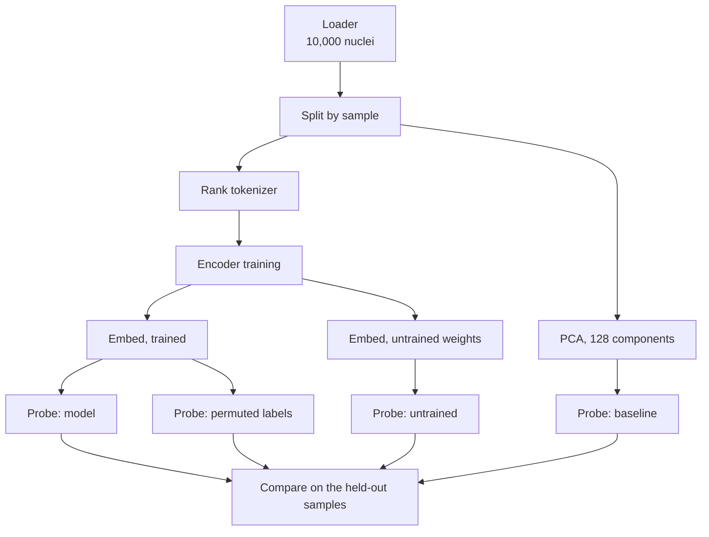

# Stage 1 on real retina cells: design and benchmarks

Written on 15 November 2026, **before the first run on real cells**. The results section at the end is added afterwards and does not change anything above it.

## The question

Does the smallest model (tier S: 4 layers, width 128), trained by masked-gene prediction on real retina nuclei, give cell representations that predict cell type on held-out samples at least as well as a simple baseline?

## Data

GSE239410, single-nucleus RNA of the zebrafish retina after injury (Lyu et al. 2023, [doi:10.1038/s41467-023-44142-w](https://doi.org/10.1038/s41467-023-44142-w)). The deposited file holds 137,490 nuclei in 13 samples (one control; light damage and NMDA damage at six time points each) and 14 cell type labels. The article is published under CC BY 4.0; the licence recorded for the data is NCBI's general policy ([RETINA.md](RETINA.md)).

One data set only, so no gene identifier map is needed yet.

## Design

| Choice | Value | Fixed by |
|---|---|---|
| Cells | 10,000 nuclei drawn at random from all 137,490 | seed 0 |
| Split | By sample: 3 of the 13 samples held out (20%, rounded), drawn from the sorted sample names | seed 0 |
| Tokens | Genes ranked by counts scaled to 10,000 per nucleus and divided by the gene's median non-zero value in the training nuclei; up to 2,048 genes | training nuclei only |
| Vocabulary | Genes seen in at least 3 training nuclei | training nuclei only |
| Model | 4 layers, width 128, 4 heads; 15% of genes masked; AdamW at 0.001; batch of 32; full precision | |
| Training | 3,000 steps, model seeds 0 and 1 | |
| Features | Mean hidden state over the genes of a nucleus | |
| Test | Logistic regression from frozen features to the 14 deposited labels, fitted on training nuclei, scored on the held-out samples | |

## Benchmarks, fixed now

The primary measure is **macro F1 over the cell types present in the held-out samples**.

| Check | Passes when |
|---|---|
| Baseline | Model macro F1 is at least the PCA baseline's. Reported with a 95% interval of the difference, from a paired bootstrap over held-out nuclei |
| Training adds something | Model macro F1 is above that of the same model with untrained weights |
| Permuted labels | With training labels shuffled, macro F1 is below twice the chance level |
| Masked-gene loss | Held-out loss is below the gene-frequency baseline |
| Second seed | Both model seeds are reported, whatever they show |

If the PCA baseline wins, the result is reported as "the baseline wins".

## What this run cannot show, whatever the numbers

- **The labels are not independent.** They come from the authors' own analysis of the same expression data. Agreement with them shows agreement with that analysis, not correctness about biology.
- **Samples are not animals.** A sample may pool several fish. The split is by sample.
- **Samples differ by condition.** Each sample is a different treatment or time point, and there is one control. Holding out a sample also holds out a condition.
- **Rare types are few.** Some labels have under 1% of nuclei, so a 10,000-nucleus draw leaves a handful of them in the held-out samples. Macro F1 gives them full weight and will be noisy.
- **Cell classes of the retina are easy to separate.** A high score for every method is the likely outcome and would not show that the model is useful.
- **One data set, one tissue, one small model, two seeds.**

## GPU ceiling

2 GPU-hours for stage 1, set by the project lead on 15 November 2026. It covers every attempt, failed ones included. Each run has a timed start check and a ceiling of its own.
