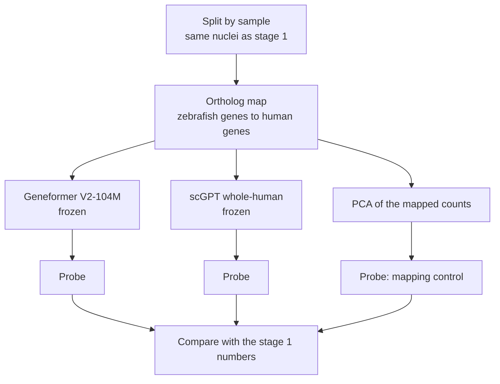

# Stage 1b: Geneformer and scGPT on the same retina test

Written on 15 November 2026, **before any of these runs**. The results section at the end is added afterwards and does not change anything above it.

## The question

On the stage 1 test ([STAGE1-RETINA.md](STAGE1-RETINA.md)), how do two published foundation models trained on human cells compare with the principal-components baseline and with this project's tier S model?

## What stays the same as stage 1

The 10,000 nuclei of GSE239410 (seed 0), the split by sample (held out: `Control_2`, `LD_96hr`, `NMDA_96hr`), the 14 deposited labels, the logistic-regression probe, and the primary measure: macro F1 over the cell types in the held-out samples.

## What is new

| Item | Choice, fixed now |
|---|---|
| Geneformer | V2-104M at Hugging Face commit `1f7fbae`, with its own tokenizer. Features: the `<cls>` position of the second-to-last layer. This is the recipe of the public repository `Kays3/geneformer-petadimension-starter`. No fine-tuning |
| scGPT | The `whole-human` checkpoint named in the scGPT README, through the package's own `embed_data` function. No fine-tuning |
| Gene mapping | Both models know human genes only. Zebrafish genes are mapped to human orthologs with the Ensembl BioMart table of release 116 |
| Mapping rule | Keep a zebrafish gene if it has exactly one human ortholog in the table. Sum the counts of zebrafish genes that share a human gene. Drop zebrafish genes with no human ortholog or with more than one |
| Control for the mapping | Principal components (128) of the mapped human-gene counts. It shows what the gene mapping alone costs, apart from any model |

## Benchmarks, fixed now

| Check | Passes when |
|---|---|
| Each external model against the stage 1 PCA baseline (0.853) | Its macro F1 is at least 0.853 |
| Each external model against the mapping control | Its macro F1 is at least that of PCA on the mapped counts. Reported with a 95% interval of the difference from a paired bootstrap over held-out nuclei |
| Each external model against the tier S model | Reported against both seeds (0.826 and 0.808); no pass mark |
| Mapping cost | Reported: the share of genes and of counts that survive the mapping, and the macro F1 lost between PCA on all genes and PCA on mapped genes |

Every result is reported, including a model that cannot be installed or run. In that case the report says "not run" and gives the reason.

## What these runs cannot show, whatever the numbers

- **This is a cross-species, zero-shot use.** Both models were trained on human cells. A low score here says little about them on human data or after fine-tuning.
- **The gene mapping removes information** before either model sees a nucleus. Zebrafish has many duplicated genes, and the rule above drops or merges them.
- **The comparison is not like for like.** Geneformer has about 104 million weights and scGPT is of similar order; the tier S model has 3.3 million and saw 7,731 nuclei. The external models saw tens of millions of human cells and no zebrafish.
- The limits of stage 1 all still apply: labels from the authors' own analysis, samples that are not animals, the one control sample held out, few nuclei of the rare types.

## Cost

These runs are charged to the stage 1 ceiling of 2.0 GPU-hours, of which 1.278 remained on 15 November 2026. Model weights are downloaded to the GPU machine and recorded in the manifest with checksums.
